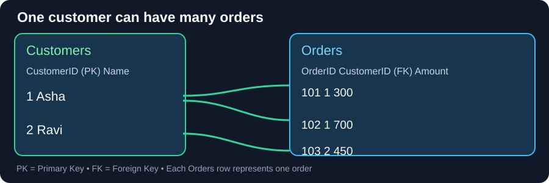

# SQL Basics — Foundation Notes

## Why do we need tables and keys?

Imagine a delivery business with 10,000 customers and 200,000 orders. Repeating a customer's full name and phone in every order causes inconsistent copies. A relational database separates **Customers** from **Orders**, then connects them using IDs.

**Start every query by asking: what does one row represent?** That is the table's **grain**.

## 1. Tables, rows and keys

**Customers** — one row per customer:

| CustomerID | Name |
|---:|---|
| 1 | Asha |
| 2 | Ravi |

**Orders** — one row per order:

| OrderID | CustomerID | Amount |
|---:|---:|---:|
| 101 | 1 | 300 |
| 102 | 1 | 700 |
| 103 | 2 | 450 |

Asha has two orders. `Customers.CustomerID` is a **primary key** (unique customer identifier); `Orders.CustomerID` is a **foreign key** (reference to a customer). A foreign key is *not* unique: many orders can belong to the same customer.

### Visual flow



```text
Customers                 Orders
1  Asha ─────────────┬──→ 101  CustomerID=1  ₹300
                     └──→ 102  CustomerID=1  ₹700
2  Ravi ─────────────────→ 103  CustomerID=2  ₹450
```

## 2. Creating a safe schema (SQLite)

```sql
PRAGMA foreign_keys = ON;

CREATE TABLE Customers (
  CustomerID INTEGER PRIMARY KEY,
  Name TEXT NOT NULL
);

CREATE TABLE Orders (
  OrderID INTEGER PRIMARY KEY,
  CustomerID INTEGER NOT NULL,
  Amount INTEGER NOT NULL CHECK (Amount >= 0),
  FOREIGN KEY (CustomerID) REFERENCES Customers(CustomerID)
);

INSERT INTO Customers VALUES (1, 'Asha'), (2, 'Ravi');
INSERT INTO Orders VALUES (101, 1, 300), (102, 1, 700), (103, 2, 450);
```

| Constraint | Why it exists |
|---|---|
| `PRIMARY KEY` | Prevent duplicate row identifiers |
| `FOREIGN KEY` | Prevent references to nonexistent customers |
| `NOT NULL` | Require a value |
| `CHECK` | Enforce a business rule, like nonnegative amounts |
| `UNIQUE` | Disallow duplicate values in a designated column |

**Important:** SQLite foreign-key enforcement needs `PRAGMA foreign_keys = ON` per connection. SQL Server has different DDL syntax and data types; this example is SQLite.

## 3. Progressive SELECT example

```sql
SELECT OrderID, Amount
FROM Orders
WHERE Amount >= 400
ORDER BY Amount DESC, OrderID;
```

| Stage | Remaining orders |
|---|---|
| `FROM` | 101 (300), 102 (700), 103 (450) |
| `WHERE Amount >= 400` | 102 (700), 103 (450) |
| `SELECT` | Keep OrderID and Amount columns |
| `ORDER BY` | 102 (700) before 103 (450) |

**Final output**

| OrderID | Amount |
|---:|---:|
| 102 | 700 |
| 103 | 450 |

For filters, DISTINCT and advanced SELECT, use the separate [Advanced SELECT foundation](../01.%20Advanced%20SELECT/0.%20Foundation%20Notes.md); no duplicate chapter here.

## 4. Types and missing values

An ID may be `INTEGER`, text may be `TEXT` in SQLite, and prices are safest represented as integer minor currency units (paise) or carefully controlled decimals. SQL Server uses `INT`, `NVARCHAR` and `DECIMAL(p,s)`. Keep leading-zero codes as text.

**NULL is not 0, empty text or the literal 'NULL'.** Use `IS NULL` or `IS NOT NULL`. Read the [NULL foundation](../11.%20NULL%20Logic/0.%20Foundation%20Notes.md).

## 5. Transactions protect related changes

```sql
BEGIN TRANSACTION;
UPDATE Orders SET Amount = 350 WHERE OrderID = 101;
SELECT Amount FROM Orders WHERE OrderID = 101; -- 350 inside transaction
ROLLBACK;
SELECT Amount FROM Orders WHERE OrderID = 101; -- 300 restored
```

`COMMIT` permanently saves a successful transaction. `ROLLBACK` undoes its changes. Use a scratch database for practice; never casually `UPDATE` or `DELETE` production data.

A **view** is a reusable query definition; an **index** can speed reads but adds storage and write costs. They solve different problems.

## JavaScript connection

Think of SQL tables as collections of objects, but with rules enforced by the database. `orders.filter(...).map(...).sort(...)` helps explain **WHERE → SELECT → ORDER BY**, though SQL NULL handling, joins and duplicates behave differently.

## Revision

- A primary key identifies; a foreign key connects.
- The grain of a customer row differs from an order row.
- SELECT chooses columns; WHERE filters rows.
- No guaranteed output order without ORDER BY.
- A written SQL query is not necessarily the database engine's physical execution plan.

## Four sources, one canonical explanation

- [Bosscoder SQL Basics original](../../99.%20Reference%20Materials/Original%20Mastery%20Snapshot/1.%20SQL%20Mastery/1.%20SQL%20Mastry/1.Bosscoder%20Academy%20-%20foundational%20notes%20and%20Assignments/0.%20SQL%20basics/0.%20Foundation%20Notes.md)
- [PNP original SQL course source](../../99.%20Reference%20Materials/Original%20Mastery%20Snapshot/1.%20SQL%20Mastery/1.%20SQL%20Mastry/2.PNP-%20foundations%20and%20practice/)
- [W3Schools official SQL SELECT](https://www.w3schools.com/sql/sql_select.asp)
- [ChatGPT Study Mode evidence archive](../../99.%20Reference%20Materials/Legacy%20Journey%20Snapshot/study-records/)

**Learning status:** Source-aligned teaching note. It does **not** credit a newly solved problem.
