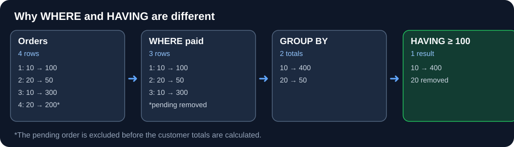

# Sorting and Grouping — Foundation Notes

## Why do we need this?

A sales table has one row per order. Your manager needs **one row per customer** showing their total spend. SQL must first decide which rows belong together, then summarize them. This operation **changes the grain**.

## 1. Original rows

| order_id | customer_id | amount | status |
|---:|---:|---:|---|
| 1 | 10 | 100 | paid |
| 2 | 20 | 50 | paid |
| 3 | 10 | 300 | paid |
| 4 | 20 | 200 | pending |

## 2. Filter → group → summarize → sort




```text
4 order rows
    ↓ WHERE status = 'paid'
3 order rows (1,2,3)
    ↓ GROUP BY customer_id
2 groups {10:[100,300], 20:[50]}
    ↓ SUM(amount)
customer 10 → 400
customer 20 →  50
```

```sql
SELECT customer_id, SUM(amount) AS paid_total
FROM Orders
WHERE status = 'paid'
GROUP BY customer_id
HAVING SUM(amount) >= 100
ORDER BY paid_total DESC, customer_id ASC;
```

**Final result**

| customer_id | paid_total |
|---:|---:|
| 10 | 400 |

Customer 20 had a pending order of 200, which is removed **before grouping**, leaving only 50. The `HAVING` clause then removes that group.

## 3. WHERE versus HAVING

| Clause | Executes conceptually | Works on |
|---|---|---|
| `WHERE status='paid'` | Before grouping | Individual source rows |
| `HAVING SUM(amount)>=100` | After grouping | Completed groups |

**JS analogy:** `filter()` rows → `reduce()` into a `Map` keyed by customer → filter summarized groups → sort. SQL handles this declaratively.

## 4. Important mistakes

- Group by **customer_id**, not a name shared by two different customers.
- A selected non-aggregated column generally must belong to the `GROUP BY`; SQLite's permissive bare-column behavior may hide a bug that SQL Server rejects.
- `ORDER BY total DESC, id ASC` gives deterministic ordering even on ties.
- `COUNT(DISTINCT product_id)` counts distinct non-NULL products, not orders.
- `GROUP BY customer_id, month` creates one row **per customer-month pair**.

## Quick revision

**Business question → row grain → input filter → group keys → aggregates → group filter → sort.** Always inspect intermediate rows before trusting a summary.

**Learning status:** Source-backed explanation; retain original Bosscoder and PNP problem IDs and individual attempts.

## Sources (kept intact)

- [Original Bosscoder 3. Sorting and Grouping foundation and assignments](../../99.%20Reference%20Materials/Original%20Mastery%20Snapshot/1.%20SQL%20Mastery/1.%20SQL%20Mastry/1.Bosscoder%20Academy%20-%20foundational%20notes%20and%20Assignments/3.%20Sorting%20and%20Grouping/0.%20Foundation%20Notes.md)
- [PNP source questions and full reference materials](../../99.%20Reference%20Materials/Original%20Mastery%20Snapshot/1.%20SQL%20Mastery/1.%20SQL%20Mastry/2.PNP-%20foundations%20and%20practice)
- [W3Schools official SQL](https://www.w3schools.com/sql/)
- [Study Mode historical evidence](../../99.%20Reference%20Materials/Legacy%20Journey%20Snapshot/10-learning-journal/)

*These canonical examples are original teaching examples. They do not claim to be the original graded problem statements or official solutions.*
