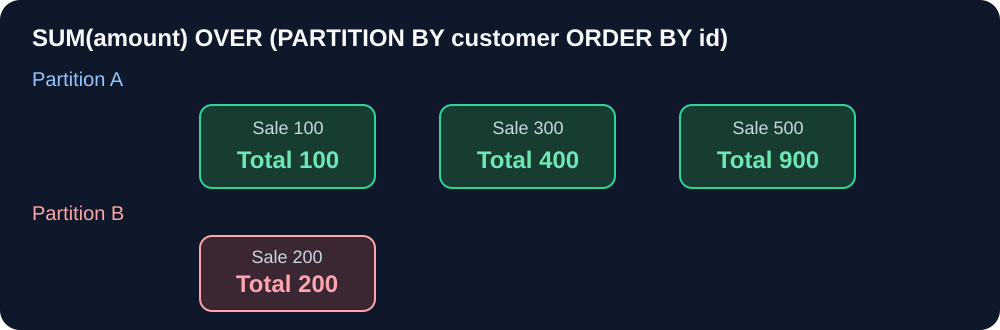

# Window Functions — Foundation Notes

## Why do we need this?

A finance team wants each transaction **and** its customer's cumulative spending. `GROUP BY` collapses rows into summaries; a **window function** adds a calculation *while keeping the original rows*.

## 1. Imagine this sales stream

| id | customer | amount |
|---:|---|---:|
| 1 | A | 100 |
| 2 | B | 200 |
| 3 | A | 300 |
| 4 | A | 500 |

We need each customer's running sum as orders arrive.

## 2. Think of windows visually




```text
Customer A:   100   →   300   →   500
Running sum:  100   →   400   →   900

Customer B:   200
Running sum:  200
```

```sql
SELECT id, customer, amount,
       SUM(amount) OVER (
         PARTITION BY customer
         ORDER BY id
         ROWS BETWEEN UNBOUNDED PRECEDING AND CURRENT ROW
       ) AS running_sum
FROM Sales
ORDER BY id;
```

**Output**

| id | customer | amount | running_sum |
|---:|---|---:|---:|
| 1 | A | 100 | 100 |
| 2 | B | 200 | 200 |
| 3 | A | 300 | 400 |
| 4 | A | 500 | 900 |

### Read `OVER()` in three parts

- `PARTITION BY customer`: restart calculation separately for A and B.
- `ORDER BY id`: establish within-customer sequence.
- `ROWS ... CURRENT ROW`: include all rows since the beginning of that partition up to the current position.

An explicit **ROWS** frame avoids accidental tie-group behavior caused by default `RANGE` frames. If the order key can tie, include a unique secondary key.

## 3. Three different ranking functions

| score | ROW_NUMBER | RANK | DENSE_RANK |
|---:|---:|---:|---:|
| 100 | 1 | 1 | 1 |
| 100 | 2 | 1 | 1 |
| 90 | 3 | 3 | 2 |
| 80 | 4 | 4 | 3 |

- `ROW_NUMBER()` assigns unique positions; add a tie-breaker for determinism.
- `RANK()` gives equal rows equal rank but leaves gaps.
- `DENSE_RANK()` gives ties equal rank with no gaps.

```sql
SELECT employee_id, salary,
       DENSE_RANK() OVER (ORDER BY salary DESC) AS salary_rank
FROM Employees;
```

## 4. Look backward or forward

`LAG(amount)` returns a previous row's value *within the defined window order*; `LEAD(amount)` returns a following value. Useful for change detection, month-over-month analysis and event sequences.

**JS analogy:** Like grouping a stream by key, sorting each group's events and attaching cumulative values via `reduce`, while preserving every original event row.

## Common mistakes

- A window `ORDER BY` affects the calculation, **not** guaranteed final output order.
- Use a CTE to filter by a window result in SQLite and SQL Server; don't put a window directly in `WHERE`.
- `GROUP BY` and window aggregates answer different row-grain questions.
- Missing/duplicate timestamps affect sequence and ranking correctness.

**Study status:** Source-backed concept note; independent source assignments still pending.

## Original source preservation

- [Bosscoder 9. Windowing Functions reference notes](../../99.%20Reference%20Materials/Original%20Mastery%20Snapshot/1.%20SQL%20Mastery/1.%20SQL%20Mastry/1.Bosscoder%20Academy%20-%20foundational%20notes%20and%20Assignments/9.%20Windowing%20Functions/0.%20Foundation%20Notes.md)
- [PNP SQL question source and materials](../../99.%20Reference%20Materials/Original%20Mastery%20Snapshot/1.%20SQL%20Mastery/1.%20SQL%20Mastry/2.PNP-%20foundations%20and%20practice)
- [Official W3Schools SQL tutorial](https://www.w3schools.com/sql/)
- [Original Study Mode history](../../99.%20Reference%20Materials/Legacy%20Journey%20Snapshot/10-learning-journal/)

*Original teaching examples are not claimed as official practice questions or independent submissions.*

## Source-specific window traps (reviewed PNP questions, not learner submissions)

**Rank ties and business choice:** A051/P042 require `ROW_NUMBER() OVER (ORDER BY metric DESC, id)` to choose unique row positions but `RANK()/DENSE_RANK() OVER (ORDER BY metric DESC)` to preserve tied *metric* values. P049's top-three **distinct unit-sales levels** require all tied products at the third level (illustrated with a `DENSE_RANK() <= 3` filter). A073 and A074 do not fully define ties at a percentile/top-three cutoff; do not silently substitute `ROW_NUMBER` and claim source fidelity.

**Two different distributions:** A054's `PERCENT_RANK()` measures rank position: for salaries 40, 60, 60, 80 its values are 0, 1/3, 1/3, 1. A055's `CUME_DIST()` measures the share at or below salary: 1/4, 3/4, 3/4, 1. Both are SQLite-supported and were executed with an independent four-row fixture. A072's median of four salaries 40,60,80,100 is **70**, whereas an odd-length sample 40,60,80 gives **60**. MySQL 8 does not provide a built-in `MEDIAN` aggregate.

**Calendar correctness:** A065 requires one row per calendar date, filling absent trading dates with revenue **0** before a `ROWS BETWEEN 6 PRECEDING AND CURRENT ROW` average; a seven-row window on *active order dates* is wrong. Its illustrated Jan 1=10, Jan 3=20, Jan 7=40 gives **70/7=10**. A062 must join to the same calendar month a year earlier, not simply `LAG(12)` over sparse observed months. P044 requires immediately previous *calendar* month even if no orders occurred; A057/A058's sparse-calendar comparison remains source-contract-sensitive.

**Peer frames:** For ordered amounts 10,10,20, an explicit deterministic `ROWS` cumulative sum is 10,20,40; with `RANGE` ordered solely by amount it is 20,20,40. Avoid adding a unique ID to the `RANGE` ORDER BY if the point is to demonstrate amount peers. SQL Server/MySQL/SQLite framing restrictions differ; this specific check ran on reviewer-generated SQLite input.

**Row grain and missing values:** P058 needs one latest order per customer by date then highest OrderID. P034's supplier share includes unknown supplier IDs and zero-line catalogue suppliers. P060 uses `OrderDetails.Quantity * Products.Sale_Price`, not a line-price field. P068 defines delivered with a valid DeliveryDate. P078 counts unsold products in its median and requires 20 products per subcategory. P097 includes non-returners in the first-category path denominator; our fixture checks only that final denominator, not full category-dominance selection.

[Read the 45 individual archived problem semantics and explicit unresolved assumptions](../PNP-WINDOW-SEMANTIC-AUDIT.md). [Reproducible reviewer-only SQLite fixtures](../../scripts/check_pnp_window_cases.py). **Source-task explanation is not a submitted learner answer or an official solution.**
